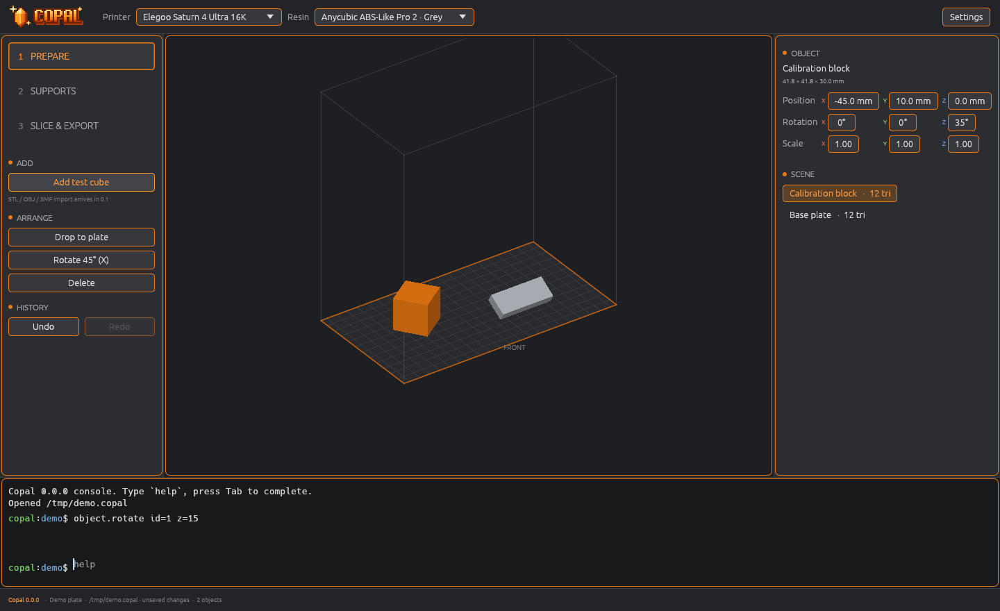
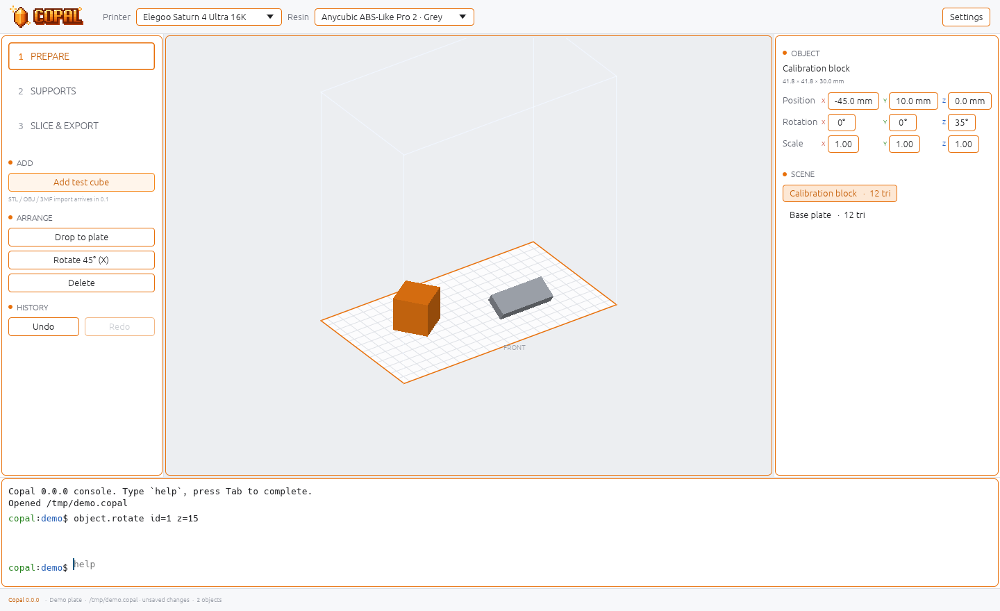
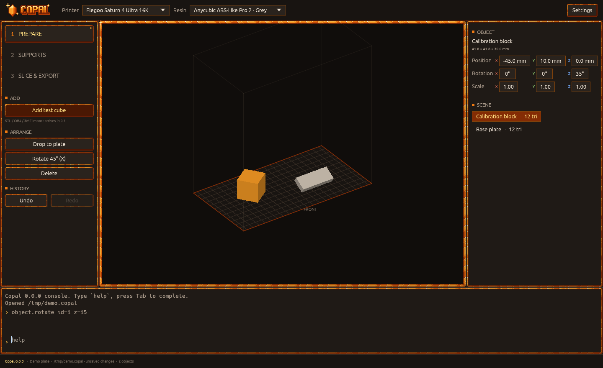

<p align="center">
  
</p>

<p align="center">
  <b>A free and open-source slicer for resin 3D printers.</b><br>
  Full-featured. No ads. No paywalls. No accounts.
</p>

<p align="center">
  <a href="LICENSE"></a>
  <a href="https://github.com/hakiguru/Copal/releases"></a>
  
  
</p>

---

> [!NOTE]
> **Copal 0.0 is an early preview.** The engine core, project files, the terminal tool and both apps
> are in place, but Copal **can't slice yet** — that comes in 0.1. Star or watch the repo to follow along.

## What is Copal?

Copal is a slicer for MSLA / LCD resin printers. It prepares 3D models for printing:
you place a model, add supports, and Copal turns it into a file your printer understands.

Good resin slicers today are closed, show ads, lock features behind a subscription,
or don't run on Linux at all. Copal wants to give everyone the full toolset for free,
on every machine, from a gaming PC to an old laptop.

*Copal* is young natural resin, still on its way to becoming amber.
The logo is a crystal of it.

<p align="center">
  
</p>

<table>
  <tr>
    <td></td>
    <td></td>
  </tr>
  <tr>
    <td align="center">Light mode</td>
    <td align="center">Art theme</td>
  </tr>
</table>

## Three ways to use it

| | Edition | For whom |
|---|---|---|
| 🟠 | **Copal** | The full app. Modern interface, a big 3D viewport, Blender-style model editing. |
| 🟡 | **Copal Lite** | The same features in a simple, fast interface. Made for weak laptops with integrated graphics. |
| ⚫ | **Copal CLI** | Everything from the terminal. Scripts, batch slicing, servers, no graphics needed. |

All three share one engine, so a project made in one opens in the others.

## Planned features

**Prepare**
- Import STL, OBJ and 3MF
- Move, rotate, scale, mirror, duplicate, auto-arrange
- Automatic orientation
- Mesh repair, hollowing, drain holes

**Supports**
- Automatic supports: light, medium, heavy
- Manual add, move and delete
- Island, overhang and suction cup detection
- Rafts and support presets

**Edit**
- Blender-style edit mode: vertices, edges, faces
- Booleans, cutting with keys, text and primitives
- Undo and redo for everything

**Slice & export**
- Fast slicing on CPU or GPU, with anti-aliasing
- Layer-by-layer preview
- Export to `.goo`, `.ctb`, Photon Workshop formats, `.sl1s`, NanoDLP and more
- Built-in printer and resin presets
- Print time, resin use and cost estimate

## Platforms

| | Copal | Copal Lite | CLI |
|---|:---:|:---:|:---:|
| Windows (installer, portable) | ✅ | ✅ | ✅ |
| Linux AppImage | ✅ | ✅ | ✅ |
| Debian / Ubuntu (`.deb`) | ✅ | ✅ | ✅ |
| Fedora / openSUSE (`.rpm`) | ✅ | ✅ | ✅ |
| Arch Linux (AUR) | ✅ | ✅ | ✅ |
| Flatpak | ✅ | ✅ | — |

*All planned.*

## Roadmap

The full plan lives in [`docs/ROADMAP.md`](docs/ROADMAP.md).
The tech design is in [`docs/ARCHITECTURE.md`](docs/ARCHITECTURE.md).
The feature checklist is in [`docs/FEATURES.md`](docs/FEATURES.md).
The user guide lives in the [wiki](https://github.com/hakiguru/Copal/wiki).

- [x] **0.0** Foundation: command system with undo/redo, project files, CLI, preview apps
- [ ] **0.1** Engine: load a model, slice it, export `.goo` and `.ctb` from the terminal
- [ ] **0.2** Copal Lite: first app with a 3D view, layer preview and resin calibration
- [ ] **0.3** Automatic and manual supports: grid, inline, projection, painting, bracing, rafts
- [ ] **0.4** Full Copal app and Windows builds
- [ ] **0.5** Orientation, hollowing, arranging, mesh repair, multi-plate, one-click prepare
- [ ] **0.6** Blender-style editing, booleans, cut with keys
- [ ] **0.7** Large printer and resin database, all major file formats
- [ ] **0.8** GPU slicing, sending to printer over Wi-Fi, advanced calibration

## Themes

- **Default** — calm dark or light colors with simple orange outlines. Easy on the eyes for long sessions.
- **Art** — warm amber colors, crystal borders and glints, in the style of the logo.

Switch in **Settings** (Ctrl+,), in the console with `settings theme=art`, or from the terminal with
`copal-cli settings theme=art mode=light`.

## Calibrate your own resin

Resin settings change with the color, the batch and even the room temperature.
Copal includes a calibration wizard: print one small test, pick the best chip, and save
settings made for **your** bottle. Built-in presets are just the starting point.
- [ ] **1.0** Stable release

## Try the preview

**Download:** grab the archive for Linux or Windows from
[Releases](https://github.com/hakiguru/Copal/releases), unpack it and run `copal`, `copal-lite` or `copal-cli`.

**Build it yourself** (needs [Rust](https://rustup.rs)):

```sh
git clone https://github.com/hakiguru/Copal
cd Copal
cargo run --release -p copal        # full app
cargo run --release -p copal-lite   # Lite
cargo run --release -p copal-cli -- --help
```

**Try the terminal tool:**

```sh
copal-cli new part.copal --printer elegoo/saturn-4-ultra-16k
copal-cli run part.copal object.add_cube size=20
copal-cli run part.copal object.rotate id=1 x=45
copal-cli run part.copal object.drop id=1
copal-cli info part.copal
copal-cli settings mode=light         # app look: theme=default|art, mode=dark|light
copal part.copal                     # open it in the app
```

## Contributing

Ideas, bug reports and printer tests are very welcome. Open an issue.
If you own a resin printer that is not on the list, your help is gold.

## License

Copal is released under the [MIT License](LICENSE). Use it, change it, sell it, ship it —
anything you like, just keep the copyright notice.

---

<details>
<summary><b>🇷🇺 На русском</b></summary>

**Copal** — бесплатный слайсер с открытым кодом для фотополимерных (MSLA/LCD) 3D-принтеров.
Полный набор функций, без рекламы, без платных подписок и без аккаунтов.

- **Copal** — полная версия: современный интерфейс и редактирование моделей в стиле Blender.
- **Copal Lite** — те же функции в простом и быстром интерфейсе для слабых ноутбуков со встроенной графикой.
- **Copal CLI** — всё то же самое из терминала, без графики.

Сборки для Windows и Linux: AppImage, deb, rpm, AUR, Flatpak.
Проект на стадии планирования. План — в [`docs/ROADMAP.md`](docs/ROADMAP.md).

</details>
