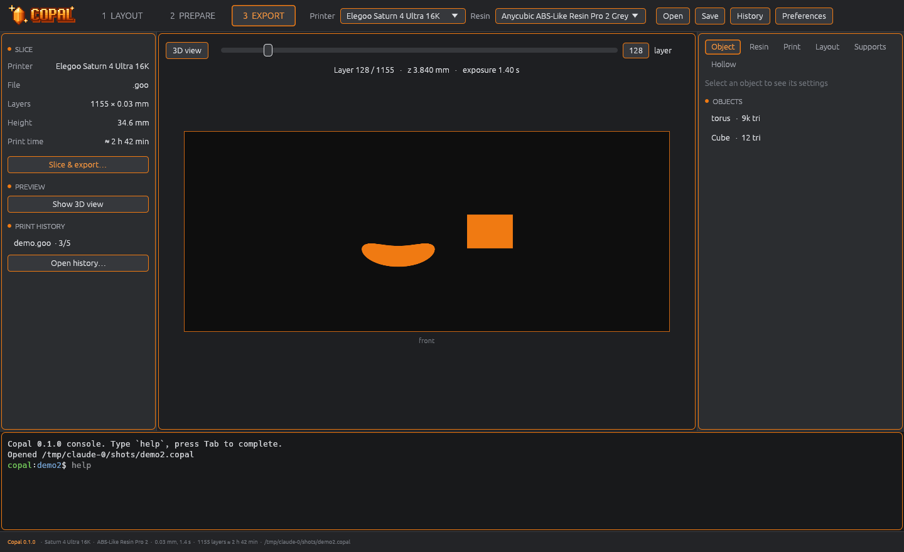
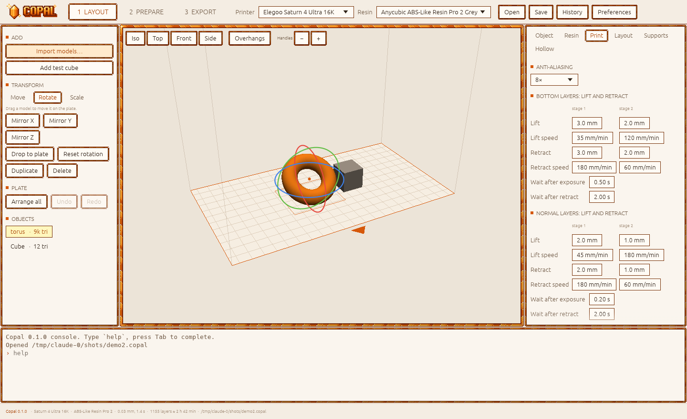

<p align="center">
  
</p>

<p align="center">
  <b>A free and open-source slicer for resin 3D printers.</b><br>
  Full-featured. No ads. No paywalls. No accounts.
</p>

<p align="center">
  <a href="LICENSE"></a>
  <a href="https://github.com/hakiguru/Copal/releases"></a>
  
  
</p>

---

> [!NOTE]
> **Copal 0.1 slices.** Import STL / OBJ / 3MF, place models with handles or by dragging them over the
> plate, set exposure and lift, look through the layers and export Elegoo `.goo` files. Supports and
> hollowing come in 0.2 → 0.3. It has not made a real print yet, so start with a small test part.

## What is Copal?

Copal is a slicer for MSLA / LCD resin printers. It prepares 3D models for printing:
you place a model, add supports, and Copal turns it into a file your printer understands.

Good resin slicers today are closed, show ads, lock features behind a subscription,
or don't run on Linux at all. Copal wants to give everyone the full toolset for free,
on every machine, from a gaming PC to an old laptop.

*Copal* is young natural resin, still on its way to becoming amber.
The logo is a crystal of it.

<p align="center">
  
</p>

<table>
  <tr>
    <td></td>
    <td></td>
  </tr>
  <tr>
    <td align="center">Layer preview</td>
    <td align="center">Light mode, resin settings</td>
  </tr>
  <tr>
    <td></td>
    <td></td>
  </tr>
  <tr>
    <td align="center">Art theme</td>
    <td align="center">Art theme, light</td>
  </tr>
</table>

## Three ways to use it

| | Edition | For whom |
|---|---|---|
| 🟠 | **Copal** | The full app. Modern interface, a big 3D viewport, Blender-style model editing. |
| 🟡 | **Copal Lite** | The same features in a simple, fast interface. Made for weak laptops with integrated graphics. |
| ⚫ | **Copal CLI** | Everything from the terminal. Scripts, batch slicing, servers, no graphics needed. |

All three share one engine, so a project made in one opens in the others.

## Features

**Works now (0.1)**
- Import STL, OBJ and 3MF — button, drag and drop, or terminal
- Move, rotate and scale with handles (size adjustable), or drag a model over the plate with the mouse
- Mirror, duplicate, drop to plate, arrange all, exact size in millimetres, snapping with Ctrl
- Overhang view: faces that need supports turn red
- Fast multithreaded slicing with anti-aliasing to Elegoo `.goo` (16K screens are fine)
- Bottom and transition layers, two-stage lift and retract, waits
- Layer-by-layer preview, print time and resin estimate
- Print history: every export with a picture, settings, rating, notes and a copy of the project
- Your own presets for exposure, motion, supports, hollowing and layout; save your own resin
- Everything also from the terminal: `copal-cli` and an interactive shell

**Coming next**
- 0.2: auto orientation, hollowing with drain holes, island check, exposure calibration, `.ctb`
- 0.3: automatic supports (light / medium / heavy), manual supports that brace themselves, editing
  every support
- Later: Blender-style edit mode, booleans and cutting, many more printers and formats, GPU
  slicing, sending to the printer over Wi-Fi

## Platforms

| | Copal | Copal Lite | CLI |
|---|:---:|:---:|:---:|
| Windows (installer, portable) | ✅ | ✅ | ✅ |
| Linux AppImage | ✅ | ✅ | ✅ |
| Debian / Ubuntu (`.deb`) | ✅ | ✅ | ✅ |
| Fedora / openSUSE (`.rpm`) | ✅ | ✅ | ✅ |
| Arch Linux (AUR) | ✅ | ✅ | ✅ |
| Flatpak | ✅ | ✅ | — |

Packages for every release are built automatically. AUR, Flathub and an apt repository are planned.

## Roadmap

The full plan lives in [`docs/ROADMAP.md`](docs/ROADMAP.md).
The tech design is in [`docs/ARCHITECTURE.md`](docs/ARCHITECTURE.md).
The feature checklist is in [`docs/FEATURES.md`](docs/FEATURES.md).
The user guide lives in the [wiki](https://github.com/hakiguru/Copal/wiki).

- [x] **0.0** Foundation: command system with undo/redo, project files, CLI, preview apps
- [x] **0.1** It slices: import, 3D view with handles, settings and presets, `.goo` export, print history
- [ ] **0.2** Prepare: auto orientation, hollowing and drain holes, islands, calibration, `.ctb`
- [ ] **0.3** Automatic and manual supports with bracing, editing every support, rafts
- [ ] **0.4** Polish of the full app: materials, history panel, macros, autosave
- [ ] **0.5** Mesh repair, multi-plate, one-click prepare, measuring
- [ ] **0.6** Blender-style editing, booleans, cut with keys
- [ ] **0.7** Large printer and resin database, all major file formats
- [ ] **0.8** GPU slicing, sending to printer over Wi-Fi, advanced calibration
- [ ] **1.0** Stable release

## Themes

- **Default** — calm dark or light colors with simple orange outlines. Easy on the eyes for long sessions.
- **Art** — warm amber colors, crystal borders and glints, in the style of the logo.

Both come in dark and light.

Switch in **Preferences** (Ctrl+,), in the console with `settings theme=art`, or from the terminal with
`copal-cli settings theme=art mode=light`.

## Calibrate your own resin

Resin settings change with the color, the batch and even the room temperature.
Copal includes a calibration wizard: print one small test, pick the best chip, and save
settings made for **your** bottle. Built-in presets are just the starting point.

## Install

Download from [Releases](https://github.com/hakiguru/Copal/releases/latest):

| System | File | How |
|---|---|---|
| **Windows** | `Copal-Setup-<version>.exe` | Run the installer. Or take `Copal-<version>-portable.exe` and just run it. |
| **Ubuntu / Debian / Mint** | `copal_<version>_amd64.deb` | `sudo apt install ./copal_<version>_amd64.deb` |
| **Fedora / openSUSE** | `copal-<version>-1.x86_64.rpm` | `sudo dnf install ./copal-<version>-1.x86_64.rpm` |
| **Arch / Manjaro** | `copal-bin.PKGBUILD` | Save it as `PKGBUILD` in an empty folder, run `makepkg -si` |
| **Any Linux** | `Copal-<version>-x86_64.AppImage` | `chmod +x` it and run |
| **Flatpak** | `copal-<version>.flatpak` | `flatpak install --user copal-<version>.flatpak` |

Files with **lite** in the name contain only Copal Lite and the terminal tool, for weak computers.
The full packages include Copal Lite too. Coming later: an apt repository, Flathub and the AUR,
so updates arrive with your system.

**Or build it yourself** (needs [Rust](https://rustup.rs)):

```sh
git clone https://github.com/hakiguru/Copal
cd Copal
cargo run --release -p copal        # full app
cargo run --release -p copal-lite   # Lite
cargo run --release -p copal-cli -- --help
```

**Try the terminal tool:**

```sh
copal-cli new part.copal --printer elegoo/saturn-4-ultra-16k --resin anycubic/abs-like-pro-2-grey
copal-cli import part.copal model.stl
copal-cli run part.copal object.rotate id=1 x=30
copal-cli export part.copal -o part.goo   # slice; also saved to the print history
copal-cli history                         # every export, rate them: history rate <id> 5 good
copal-cli shell part.copal                # interactive, `help` lists everything
copal part.copal                          # open it in the app
```

## Contributing

Ideas, bug reports and printer tests are very welcome. Open an issue.
If you own a resin printer that is not on the list, your help is gold.

## License

Copal is released under the [MIT License](LICENSE). Use it, change it, sell it, ship it —
anything you like, just keep the copyright notice.

---

<details>
<summary><b>🇷🇺 На русском</b></summary>

**Copal** — бесплатный слайсер с открытым кодом для фотополимерных (MSLA/LCD) 3D-принтеров.
Полный набор функций, без рекламы, без платных подписок и без аккаунтов.

- **Copal** — полная версия: современный интерфейс и редактирование моделей в стиле Blender.
- **Copal Lite** — те же функции в простом и быстром интерфейсе для слабых ноутбуков со встроенной графикой.
- **Copal CLI** — всё то же самое из терминала, без графики.

Сборки для Windows и Linux: AppImage, deb, rpm, AUR, Flatpak.

С версии 0.1 Copal нарезает модели в `.goo` для Elegoo: импорт STL / OBJ / 3MF, гизмо для
перемещения, поворота и масштаба (размер гизмо настраивается), перетаскивание модели по столу,
настройки смолы и печати с сохранением своих пресетов, предпросмотр слоёв и история печати с копией
проекта. Дальше: автоориентация и опустошение (0.2), автоподдержки и ручные поддержки (0.3).
План — в [`docs/ROADMAP.md`](docs/ROADMAP.md).

</details>
